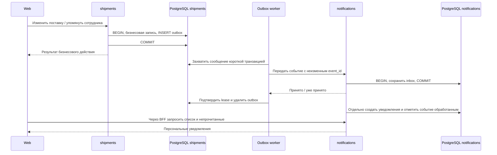

# RFC: серверные уведомления и надёжная доставка событий

> Решение после обсуждения: используем существующие outbox и библиотечный
> компонент доставки. Новый STQ, центральный relay и CDC не вводим.
> Первая реализация описана в [README сервиса](../../services/notifications/README.md):
> изменение маршрута → надёжный приём → личное уведомление назначенному логисту.
> Настраиваемые правила, email и расписания ниже — целевая архитектура,
> а не уже реализованные возможности. Для короткого первого сценария inbox
> и уведомление сохраняются одной транзакцией без дополнительного worker.


Статус: проект для архитектурного обсуждения, не описание готовой реализации.
Дата: 2026-11-05. Область: Broker.

## Решение в одном абзаце

Использовать существующий transactional outbox для надёжного выхода событий из
доменных сервисов. Получатель `notifications` сначала атомарно сохраняет событие
в inbox и лишь затем подтверждает приём. Отдельная обработка создаёт персональные
уведомления. Web читает их через BFF и хранит прочтение на сервере. Почтовые
доставки, задачи подготовки отчётов и расписания имеют собственные состояния и
не выполняются в транзакции изменения поставки. Первая реализация охватывает
внутренний центр и один реальный тип события; универсальная шина и конструктор
автоматизаций в неё не входят.

## Зачем и для каких сценариев

1. Упоминание сотрудника в поставке: уведомить конкретного участника организации.
2. Изменение этапа поставки: применить правила организации, уведомить сотрудников
   и позднее контакты клиента по почте.
3. Подготовка экспорта: после завершения серверной задачи предложить скачать архив.
4. Расписание отчётов: вторник и четверг в 14:00 в часовом поясе организации,
   создание задачи формирования и доставка результата руководству.

Текущий центр Web хранит события только в памяти страницы. Его локальные ошибки
сохранения и валидации не являются доменными событиями. Сохранять каждое такое
сообщение на сервере не требуется. Серверные и локальные записи можно показывать
в одном центре, но у них различаются жизненный цикл и гарантии.

## Границы ответственности

| Участник | Ответственность | Чего он не делает |
| --- | --- | --- |
| shipments, finance и другие владельцы данных | Авторизация бизнесового действия, сохранение изменения и факта события | Не отправляют письма и не ждут notifications |
| Общая библиотека доставки | Сериализация конверта, enqueue в локальной транзакции, регистрация обработчика outbox, сервисная аутентификация | Не вычисляет бизнесовые правила и не открывает собственную транзакцию вместо переданной |
| notifications: приём | Проверка отправителя, схемы, идемпотентности и долговечное сохранение события | Не вызывает профильные сервисы внутри транзакции приёма |
| notifications: обработка | Правила адресации, материализация уведомлений, позднее планы доставки по каналам | Не меняет этапы поставок и не формирует финансовые отчёты |
| organizations | Членство, роли и идентичность сотрудников | Не хранит историю уведомлений |
| Сервис отчётов / профильный сервис | Снимок параметров отчёта, выполнение, файл результата, проверка скачивания | Не владеет расписанием рассылки и прочтением уведомлений |
| Почтовый адаптер | Отправка через провайдера, статусы и callbacks | Не решает, кого считать клиентом поставки |

Расписания сначала могут быть модулем notifications. При появлении общих задач,
не связанных с уведомлениями, границу планировщика нужно пересмотреть.

## Путь события



HTTP здесь — транспорт доставки, не синхронная зависимость бизнесовой ручки.
Получение HTTP-запроса, запись inbox, создание уведомления и прочтение сотрудником
— четыре разных факта.

## Почему транзакция передаётся в библиотеку

Изменение данных и запись события должны иметь одну судьбу. Сбой после коммита,
но до обычного HTTP-вызова иначе создаёт потерянное уведомление. Отправка до
коммита создаёт обратную проблему: уведомление о несуществующем изменении.

Передача транзакции означает один дополнительный локальный INSERT и его индексы,
WAL и будущую уборку. Она не означает сетевой запрос, получение сервисного токена,
рендеринг текста, выбор email-адресов или подготовку отчёта. COMMIT остаётся один,
но дополнительная SQL-команда добавляет обращение к БД и время удержания транзакции.
Не утверждаем, что это бесплатно или обязательно быстрее альтернатив: нужен замер.

Ошибка enqueue откатывает бизнесовую транзакцию. Это осознанная связь с локальной
БД, а не с доступностью notifications. Обещание «событие обязательно следует за
изменением» несовместимо с незаметным игнорированием ошибки записи события.

Не все действия требуют такой гарантии. Временный toast, аналитика интерфейса и
уведомление об обычном автосохранении не должны добавлять outbox в бизнесовую ручку.

## Гарантии и условия

| Ситуация | Ожидаемое поведение |
| --- | --- |
| Бизнесовая транзакция откатилась | Ни изменения, ни outbox-события |
| COMMIT успешен, процесс упал | Событие остаётся в локальной БД |
| notifications недоступен | Бизнесовая ручка продолжает работать; очередь растёт |
| notifications сохранил inbox, ответ потерялся | Повтор с тем же event_id; нового эффекта нет |
| Процесс отправителя упал до удаления outbox | Возможна повторная отправка |
| Получатель упал во время обработки inbox | Уведомления и processed-состояние откатываются вместе; повторная обработка |
| Событие постоянно некорректно | Карантин с причиной, метрикой и возможностью управляемого повтора |
| БД переполнена из-за backlog | Записи, включая бизнесовые, могут перестать работать; нужны лимиты и алерты |
| Бэкап восстановлен на более ранний момент | Возможны повторы и потеря изменений после точки восстановления; это не исправляет одна библиотека |

Транспорт: at-least-once. Внутри notifications — один логический эффект по
уникальным ограничениям, пока сохраняется запись дедупликации. Нет обещания
«exactly once end-to-end». Доставка зависит от сохранности БД, восстановления
доступности, запуска воркеров и устранения постоянных ошибок.

Ответ «принято» отправляется только после COMMIT inbox. Если запись уже существует,
проверяем совпадение содержимого. Тот же ID с другим payload — конфликт, а не успех.
Ответ не означает, что письмо доставлено, прочитано или даже уже подготовлено.

## Контракт события и подключение разработчиком

Предыдущий пример `notifications::Enqueue(... MentionedInShipment ...)` слишком
связывает доменный сервис с уведомлениями. Предпочтительно публиковать доменное
событие, которое сегодня получает notifications, а впоследствии и другой потребитель.
Это не требует немедленно создавать универсальный event bus.

Пример целевого API; названия ещё не реализованы:

```cpp
shipment_events::Publish(transaction, EmployeeMentioned{
    .EventId = persisted_event_id,
    .OrganizationId = organization_id,
    .ShipmentId = shipment_id,
    .MentionId = mention_id,
    .RecipientId = employee_id,
    .AuthorId = author_id,
});
```

EventId относится к событию бизнесовой операции, а не к HTTP-попытке доставки.
Повтор пользовательской команды тоже должен быть идемпотентен: outbox не устраняет
две разные бизнесовые операции, случайно созданные повторным POST. Упоминание
получает собственный устойчивый ID, повторный текстовый тег не считается новой
отправкой без определённого бизнесового правила.

Конверт содержит `event_id`, `event_type`, `schema_version`, `organization_id`,
`aggregate_type/id`, `aggregate_revision`, `occurred_at`, `actor`, `payload`.
Producer определяется из сервисной аутентификации, а не из доверенного поля тела.
Идентичность адресата: устойчивый ID участника организации с отображением на
issuer/subject; пока общего ID нет, используем issuer + subject + organization.
Имя сотрудника не является идентификатором.

Данные минимальны и версионированы: ID, факт изменения и необходимые снимки.
Не передаём всю поставку, токен пользователя, HTML, SQL, email-шаблон или произвольный URL.
`occurred_at` — настоящее время факта, revision — отдельный номер версии.
Структурированные параметры позволяют перевести текст по локали получателя.
Изменение смысла события требует новой версии; сохранённые события старых версий
должны оставаться читаемыми при последовательном раскатывании сервисов.

Для подключения сервиса разработчик добавляет зависимость/конфигурацию в manifest,
миграцию outbox через кодген, разрешённый тип события и вызов Publish. Обработчик
HTTP-доставки и получение сервисного токена предоставляются общим компонентом.
Новый тип события всё равно требует доменной схемы, обработчика/правила и теста:
«автоматически обрабатываем любой JSON» не является целью.

## Текущее состояние общей outbox: архитектурное ревью

Проверено по `libs/outbox`, а не предполагается из названия паттерна:

- Enqueue выполняет INSERT в переданную транзакцию; уникальность `(topic, message_key)`.
- После подтверждения строка удаляется. Эта уникальность НЕ является постоянной
  дедупликацией: событие может снова попасть в очередь после удаления.
- Claim использует `FOR UPDATE SKIP LOCKED`, записывает lease_token и увеличивает attempts.
  Send выполняется после завершения SQL-захвата, без удержания бизнесовой транзакции.
- Complete проверяет lease и generation. Это защищает локальное подтверждение,
  но не предотвращает повторный внешний HTTP-вызов.
- Есть параллельные слоты по topic и общий предел; медленный topic не занимает все
  зарезервированные слоты другого. Общие БД и HTTP-пулы всё равно могут конкурировать.
- Повтор сейчас линейный: `min(max_retry, attempts * retry_seconds)`, без jitter.
  Любое std::exception назначает повтор. Разделения постоянных и временных ошибок нет.
- Автоматического продления lease в компоненте нет. Таймаут HTTP должен быть меньше
  lease с запасом; длинная попытка может пересечься с захватом другим воркером.
- ORDER BY available_at,id и параллельность не гарантируют порядок событий агрегата.
- EnqueueLatest заменяет ожидающий payload и generation. Это правильно для проекций
  последнего состояния, но НЕ для упоминаний, смен этапов и запланированных запусков.
- Возраст очереди, количество сообщений, ошибки и повторы уже измеряются.

Нужные дополнения перед использованием для обязательных уведомлений: классификация
ошибок, карантин и повтор из него, контроль таймаута относительно lease, jitter,
наблюдаемость каждого перехода. Изменения общего компонента должны сохранить
поведение существующих топиков и быть проверены их тестами.

## Inbox, уведомление и доставка — разные сущности

Предлагаемая логическая модель, не финальная DDL:

| Сущность | Ключ и состояния | Назначение |
| --- | --- | --- |
| inbox_events | UNIQUE(producer,event_id); accepted, processing, processed, quarantined | Долговечный приём, исходный payload/hash, обработка и повторы |
| notifications | id, org, recipient, event_id, kind, params, entity/action, occurred_at, created_at, read_at | Персональный центр, не очередь задач |
| deliveries, позднее | UNIQUE(notification_id,channel,destination_version); pending, sending, accepted, delivered, failed, cancelled | Отправка по каналу, отдельные попытки и ответ провайдера |
| notification_rules, позднее | org, event_type, filters, recipient policy, channels, revision | Декларативные правила организации |
| schedules / runs, позднее | schedule_id, revision, timezone, next_run_at; UNIQUE(schedule_id,scheduled_for) | Расписание и устойчивый запуск |

Материализация notification и отметка processed выполняются в одной транзакции.
Дополнительная уникальность `(producer,event_id,recipient,notification_kind)` защищает
fan-out от дублей. Для большого списка получателей нужны батчи и устойчивые
персональные ключи; не держим огромную транзакцию и не вызываем HTTP под блокировками.

Обработчик события может запросить актуальные сведения до транзакции материализации.
Выбранные получатели и версия правила фиксируются при первом успешном планировании,
а не перевычисляются при каждом повторе доставки. Состояние членства и ограничения
на передачу данных проверяются ещё раз при выдаче/отправке; это не повод добавлять
новых получателей задним числом.

Срок хранения уведомлений отделён от срока дедупликации. Стирание уведомления не
должно разрешать старому событию создать его снова. Предлагаемый старт: история
90 дней, идентификаторы обработанных событий 180 дней, автоматические повторы до
явно заданного максимального возраста с последующим карантином. Это продуктовые
настройки для согласования. Replay старше окна дедупликации требует отдельной
процедуры, а не обычного повторного HTTP.

## Порядок и актуальность

Уведомление не изменяет текущее бизнесовое состояние, поэтому первым вариантом
не обещаем строгий порядок обработки. Храним и время факта, и время получения,
и ревизию агрегата; запоздавший факт остаётся историческим фактом.

Три перехода этапа — три разных события, не один ключ shipment_id. Ревизию нельзя
использовать для безусловного отбрасывания всех более старых событий: потеряем
легитимное промежуточное событие. Для внешней почты организация должна выбрать:
сообщать каждый факт, только актуальное состояние либо объединять изменения в окно.
По умолчанию не строим автоматический клиентский email на неуточнённой семантике.

Если для конкретного сценария нужен строгий порядок, нужны отдельный механизм
сериализации по aggregate_id и обработка пропущенных ревизий либо подходящий
транспорт. Наличие поля revision само по себе порядок не обеспечивает.

## Безопасность и конфиденциальность

- Внутренний publish недоступен обычному пользовательскому токену. Отдельные
  сервисные клиенты и разрешённые для них типы событий; не один общий publisher-секрет
  для всех сервисов. Producer из доверенной identity.
- Доменный сервис проверяет право автора выполнить действие и допустимость адресата.
  notifications проверяет tenant, состояние получателя и политику доставки.
- Чтение/прочтение/удаление: org + identity текущего пользователя в каждом SQL.
  Body с чужим recipient_id не даёт доступа к чужому ящику.
- Упоминание не выдаёт доступ к поставке. Для чувствительных событий нужен действующий
  доступ до показа содержимого, а не только при переходе по ссылке. В MVP текст центра
  минимален; суммы, груз и контакты в payload без необходимости не включаем.
- При отзыве членства прежние записи недоступны. При повторном приглашении политика
  старой истории определяется идентичностью/поколением членства, а не совпадением имени.
- Действие — разрешённый тип и ID объекта. Web строит внутренний route по whitelist.
  Отсутствие кнопки при нехватке прав не заменяет серверную проверку на объекте.
- Файлы скачиваются через проверку доступа к задаче/результату. Истёкшая ссылка
  не означает потерю уведомления; показываем понятное истечение срока.
- Payload, адреса и ID пользователя не становятся labels метрик. Содержимое писем
  и сервисные токены не пишутся в HTTP-логи.
- Подписанные callbacks почтового провайдера проходят проверку и дедупликацию.

## Web и синхронизация прочтения

Публичные операции: список с keyset-пагинацией, счётчик, отметить выбранные IDs
прочитанными, очистить свои записи. Серверные read_at и dismissed_at монотонны;
повтор запроса безопасен. «Прочитать все» относится к показанному снимку, чтобы
новое событие во время запроса случайно не стало прочитанным.

Начать с polling раз в 20 секунд с jitter, только при видимой странице, без
параллельных запросов; после возврата фокуса обновлять сразу, после ошибок — backoff.
Значения предварительные, зависят от нагрузки. SSE позже ускорит сигнал об изменении,
но БД и повторное чтение останутся источником истины.

Автоинкрементный ID не обязательно соответствует порядку COMMIT. Нельзя считать
«последний полученный ID» безусловно безопасным курсором всех новых событий:
другая транзакция с меньшим ID может закоммититься позже. В первом варианте polling
перечитывает верхнюю страницу и счётчик с merge по ID, без обещания полного стрима;
вся история доступна отдельной пагинацией. Для lossless потока нужен курсор с явно
определённым порядком публикации/снимков. Уведомления не считаются прочитанными
просто от открытия панели.

Локальные toast остаются отдельными и не отправляются серверу. Серверные записи
не обрезаются до 100 в памяти навсегда: центр загружает историю страницами.

## Почта: границы гарантий

Провайдер может принять письмо, а HTTP-ответ потеряться. Если провайдер не поддерживает
идемпотентный send, повтор способен отправить второе письмо. Message-ID не является
универсальной гарантией дедупликации у адресата. Нужен провайдерский idempotency key
либо отдельная политика ambiguous-результата с проверкой статуса/ручным разбором.
Нельзя одновременно обещать отсутствие потерь и дублей при неизвестном результате.

Accepted у провайдера не означает доставку в почтовый ящик, а delivered не означает
прочтение человеком. Bounces, жалобы и запрет дальнейшей отправки имеют свои статусы.
Шаблоны, локаль, получатели и при необходимости параметры фиксируются для доставки.
Повтор не должен незаметно заменить адрес или содержимое письма на новое.

## Расписания и отчёты: расширение, а не часть первого ПР

Расписание: дни недели, локальное время, IANA timezone, next_run_at в UTC, состояние
и revision. Не храним только cron без часового пояса. Для переходов летнего времени
нужна политика: пропущенное локальное время и двукратное время обрабатываются явно.
Предложение по умолчанию: один запуск на локальное вхождение; при несуществующем
времени — ближайшее допустимое после него. Это требует тестов и согласования.

Захват due-расписания, запись уникального run и outbox-команды формирования отчёта
выполняются атомарно. Ключ запуска — schedule_id + scheduled_for, а не время ретрая.
Команда формирования содержит run_id; сервис отчётов тоже дедуплицирует запуск.
Перезапуск пода не создаёт второй отчёт и вторую рассылку за одно вхождение.

После простоя не рассылаем автоматически все пропущенные отчёты: по умолчанию
один актуальный запуск в согласованном окне, остальные пропущены с учётом в истории.
Параметры отчёта, период, recipients и версия расписания фиксируются в run.
Изменение/отключение расписания отменяет ещё не начатые запуски; начатые требуют
явной политики. Напоминания по дате поставки имеют ключ сущности и generation:
смена даты инвалидирует старое напоминание. Проверка generation нужна и перед
формированием/отправкой, но уже отправленное письмо отменить нельзя.

Формирование отчёта — отдельная долговечная задача с состояниями и артефактом,
а не вызов генерации PDF внутри send-callback outbox. Событие ReportReady запускает
доставку. Хранилище файлов, срок хранения и проверка скачивания принадлежат задаче.

## Производительность и эксплуатация

Критический путь измеряется целиком: HTTP-авторизация, бизнесовый SQL, enqueue,
COMMIT. Сравниваем p50/p95/p99, throughput, ошибки, WAL и рост таблицы при одинаковой
нагрузке и бизнесовых данных. Размер payload и количество событий на запрос ограничены.
Запрос с массовым упоминанием не должен незаметно выполнять тысячи enqueue/проверок.

Отдельно измеряем end-to-end задержку: occurred_at → inbox accepted → notification
created → Web visible. Отключение notifications на 10–30 минут должно накапливать
backlog без сетевых ожиданий в бизнесовой ручке; после восстановления очередь
выгружается с ограниченной конкуренцией и не лишает ресурса обычные запросы.

Для outbox резервируем слоты/ресурсы topic, проверяем TTL lease, SQL/HTTP-таймауты.
Пулы и task processor при необходимости отделяются по фактической конкуренции.
Раздувание очереди — реальная обратная связь на бизнес: запас диска, autovacuum,
размер WAL, max age и предел fan-out должны мониториться. При перегрузке нельзя
молча выбрасывать обязательные события. Ограничиваем необязательные массовые
источники, включаем алерты и при необходимости явно отклоняем новые операции.

Новые метрики: inbox lag/size, quarantined по типу/причине, fan-out duration,
notification-created latency, read/list p95, polling errors, provider errors.
Существующие метрики outbox переиспользуются. Trace связывает event_id с исходной
операцией, но event_id не label метрики. Нужны просмотр проблемного события и
управляемый replay с аудитом. Outbox удаляет доставленные строки и не является
журналом аудита всех событий.

## Альтернативы

| Вариант | Плюс | Недостаток / вывод |
| --- | --- | --- |
| Прямой HTTP в ручке | Мало кода | Зависимость по задержке/доступности, неатомарная запись в две БД; не выбираем |
| Fire-and-forget после COMMIT | Нет ожидания | Потеря при падении процесса; только для явно необязательных сигналов |
| Отдельная запись outbox после COMMIT | Меньше в транзакции | То же окно потери; не обеспечивает требуемую атомарность |
| Transactional outbox + HTTP + inbox | Переиспользование текущей инфраструктуры | Дополнительная запись, polling, нет общего replay/fan-out из коробки; выбираем для первого шага |
| CDC логического журнала | Захват коммитов без явного SQL enqueue при наблюдении бизнесовых таблиц | Эксплуатация replication slots, WAL lag, схема БД становится контрактом. CDC outbox всё равно требует запись события |
| Kafka / RabbitMQ и подобный брокер | Буферизация и потребители; подходящие модели routing/retention | Сам по себе не решает атомарность с PostgreSQL, порядок зависит от модели; добавляем при подтверждённой потребности |
| Движок долговечных процессов | Полезен для многошаговых процессов/таймеров | Не заменяет продуктовые права, адресацию и историю уведомлений; пока лишняя инфраструктура |

## Итог архитектурного ревью

Рекомендация: принять направление условно, после проверки первого сквозного сценария.

До релиза обязательны:

1. Зафиксировать событие и получателя; выбрать начальный сценарий. Упоминания ещё
   требуют продуктового места ввода (например, комментарий), парсинга и хранения.
   Не добавлять временную ручку «послать кому угодно» ради демонстрации.
2. Inbox, устойчивая идемпотентность и конфликт при изменившемся payload с тем же ID.
3. Auth service-to-service, tenant/recipient isolation, отсутствие выдачи прав через тег.
4. Классификация повторов/карантин, таймауты меньше lease, алерты очередей.
5. Серверный центр и прочтение между двумя сессиями, восстановление после refresh.
6. Нагрузочные и отказные тесты, особенно потерянный ответ и повтор бизнесовой команды.

Не делаем заранее: универсальный event bus, почтовую рассылку, UI правил, произвольный
cron-конструктор, генератор отчётов или обещание exactly-once. Сейчас создан только
каркас notifications; перечисленные контракты и API библиотек являются предложением.

## Проверки принятия

- Откат бизнесовой транзакции не создаёт уведомления.
- Падение после COMMIT и потеря ответа получателя не теряют событие и не дублируют эффект.
- Два отправителя одного event_id и два воркера одного inbox дают один результат.
- Повтор с другим payload отклоняется и наблюдаем, а не подтверждается как успех.
- Истечение lease во время send безопасно для получателя; просроченный Complete не удаляет новый захват.
- Некорректное событие уходит в карантин, временный 5xx повторяется, 401/403 не теряется молча.
- Смена организации/пользователя не открывает чужие события, прочтение синхронизируется.
- Отключённый получатель, отозванный доступ и удалённый объект не раскрывают содержимое.
- Большой backlog не блокирует другой topic и не нарушает согласованный бюджет задержек записи.
- Старый producer/new consumer и новый producer/старый consumer проверяются контрактами релиза.

## Источники и код

- [AWS: Transactional outbox](https://docs.aws.amazon.com/prescriptive-guidance/latest/cloud-design-patterns/transactional-outbox.html): dual-write, повторы, границы атомарности.
- [PostgreSQL: SELECT / SKIP LOCKED](https://www.postgresql.org/docs/current/sql-select.html): механизм конкурирующих потребителей очереди, не универсальная гарантия порядка.
- [Idempotent Consumer](https://microservices.io/patterns/communication-style/idempotent-consumer.html): фиксация ID обработанных сообщений в транзакции эффекта.
- Реальная библиотека: `libs/outbox/src/component.cpp`, `libs/outbox/include/platform/outbox/worker.hpp`, SQL в `libs/outbox/postgresql/queries`.
- Подключение в Broker: `docs/outbox.md`, `services/shipments/src/components/transportation_dispatcher.cpp`.
